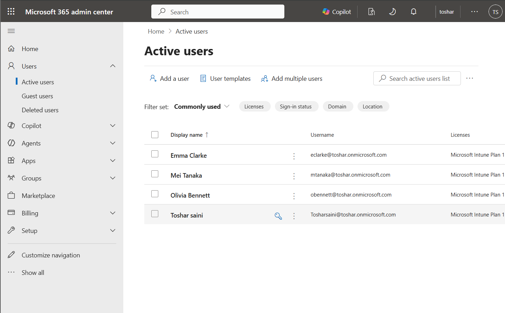
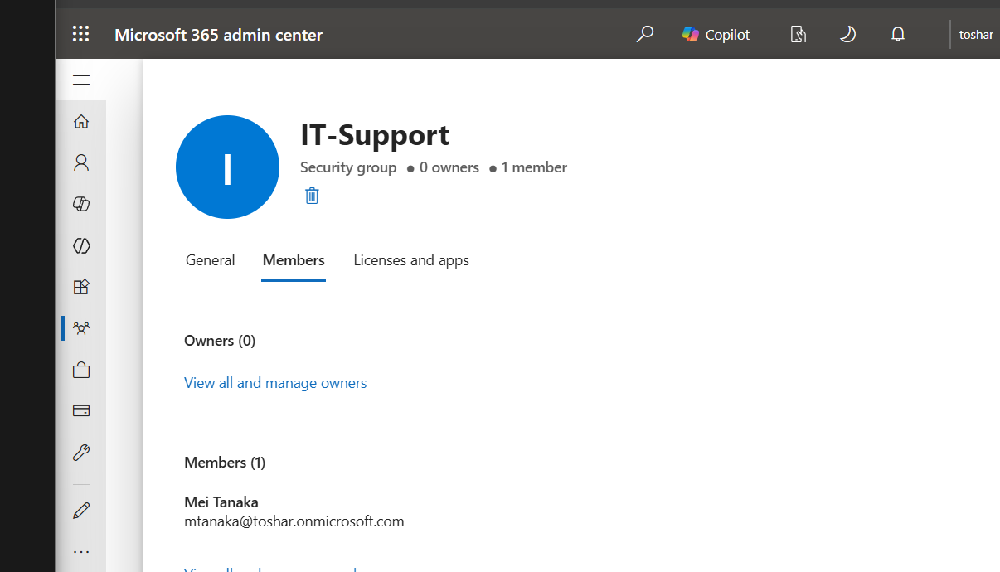
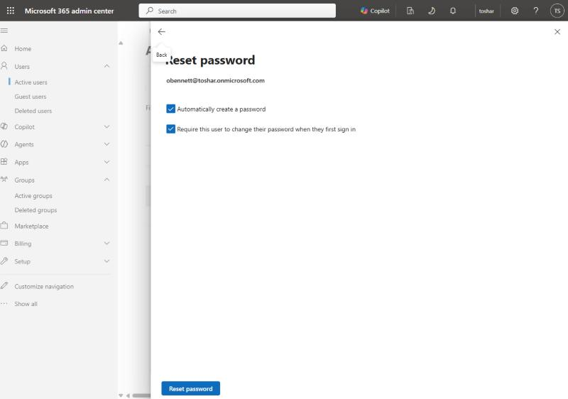
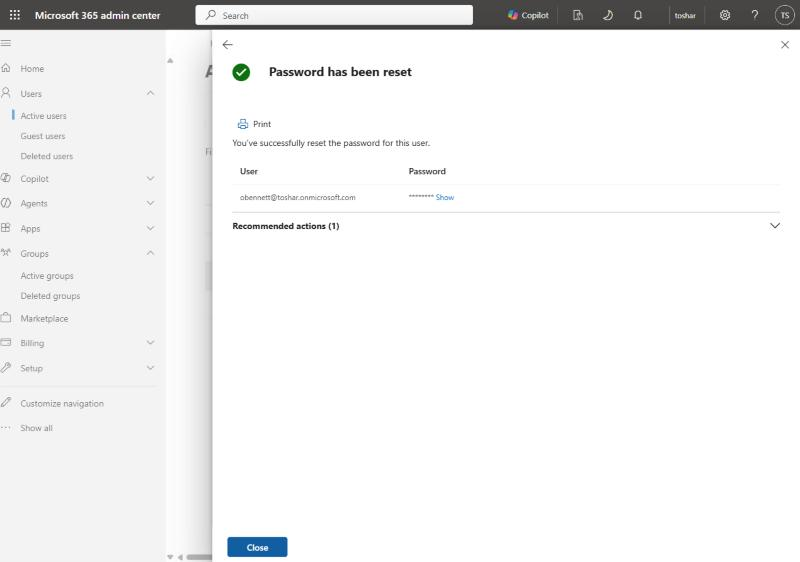
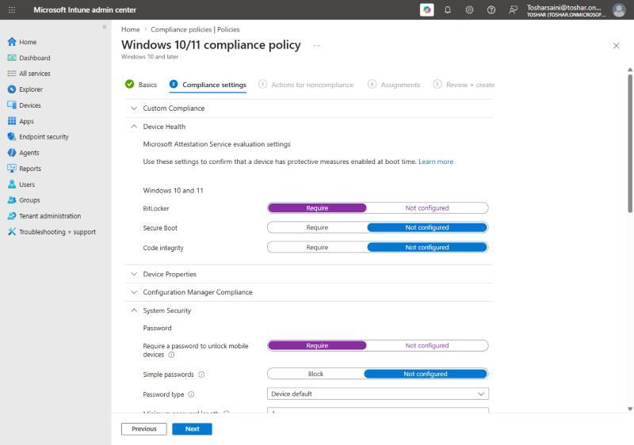
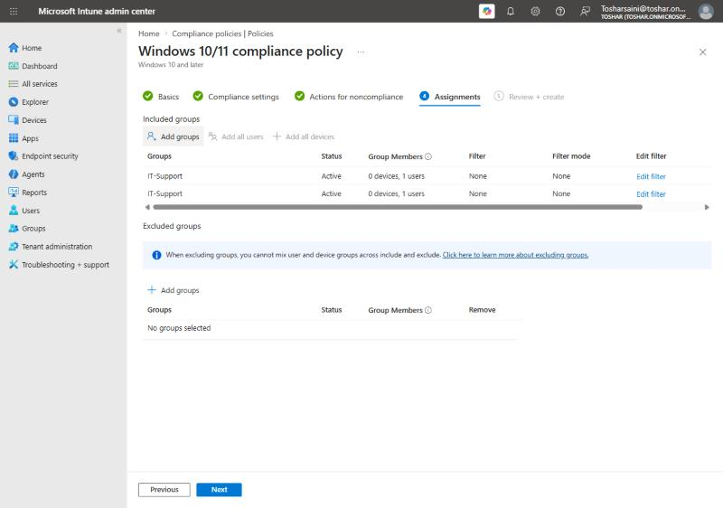
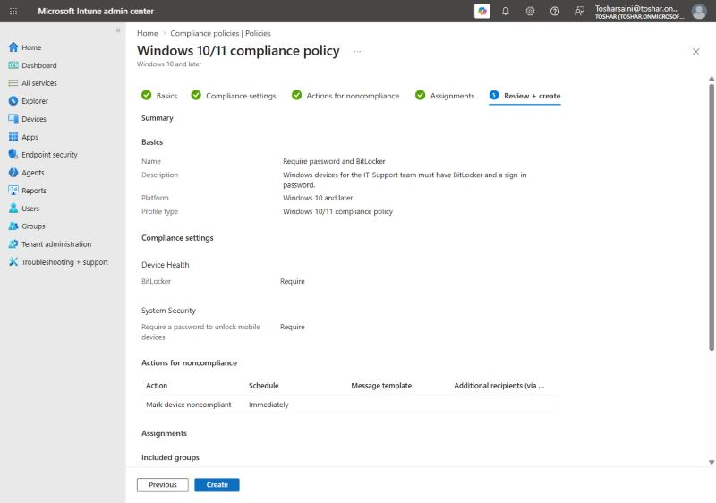
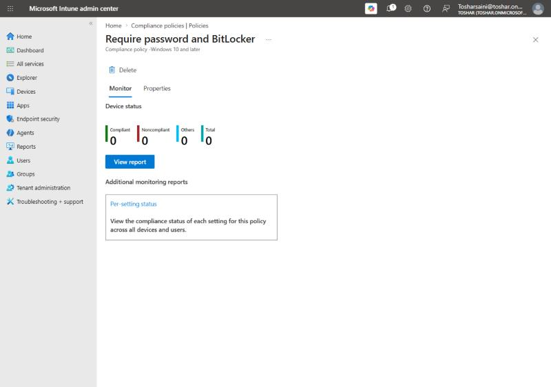

# Microsoft 365, Entra ID & Intune Help Desk Lab

A cloud identity and device-management lab built in a Microsoft 365 tenant to practise the day-to-day tasks of an IT help desk / junior system administrator: onboarding users, managing groups, resetting passwords and enforcing device security with Intune.

This lab is the cloud companion to my on-premises [Active Directory Home Lab](https://github.com/tosharsaini/active-directory-home-lab).

## Environment

| Item | Details |
|---|---|
| **Tenant** | `toshar.onmicrosoft.com` (Microsoft 365 trial) |
| **Licensing** | Microsoft Intune Plan 1 |
| **Admin portals** | Microsoft 365 admin center, Microsoft Entra admin center, Microsoft Intune admin center |
| **Users** | Emma Clarke, Mei Tanaka, Olivia Bennett (plus the global admin account) |

## What I did

### 1. User onboarding
Created three employee accounts in the Microsoft 365 admin center and assigned each an Intune Plan 1 licence.

### 2. Security group for the IT team
Created an **IT-Support** security group and added Mei Tanaka as a member. Groups are used to target policies and access, so new team members get the right settings just by being added to the group.

### 3. Help-desk ticket: password reset
Simulated a common ticket — *"Olivia Bennett is locked out and has forgotten her password."*
- Reset the password from the admin center with an auto-generated temporary password
- Required the user to **change the password at next sign-in**, so the help desk never knows the user's real password

### 4. Device compliance policy in Intune
Created a Windows 10/11 compliance policy, **Require password and BitLocker**:

| Setting | Value |
|---|---|
| Platform | Windows 10 and later |
| Device Health → BitLocker | **Require** |
| System Security → Require a password to unlock | **Require** |
| Action for noncompliance | Mark device noncompliant immediately |
| Assigned to | IT-Support group |

Any IT-Support device without disk encryption or a sign-in password is reported as noncompliant, which can then be used with Conditional Access to block access to company data.

## Skills shown

- Microsoft 365 user and licence administration
- Microsoft Entra ID security groups
- Secure password-reset procedure (temporary password + forced change)
- Microsoft Intune device compliance policies (BitLocker, password requirements)
- Policy targeting with group assignments
- Documenting work as help-desk tickets

## Screenshots

**1. Active users with Intune licences**

**2. IT-Support security group and its member**

**3. Resetting Olivia Bennett's password**

**4. Password reset confirmed (user must change it at next sign-in)**

**5. Compliance settings: BitLocker and password required**

**6. Policy assigned to the IT-Support group**

**7. Review before creating the policy**

**8. Policy created and ready to monitor device compliance**

## Lessons learned

- **Two groups with the same name:** I ended up with two *IT-Support* groups. Entra ID allows duplicate display names, so a policy can silently target the wrong group. Checking the member count before assigning, and using clear unique names, avoids this.
- **Licensing matters:** Intune features only appear once a user has an Intune licence assigned.
- **Never set a password the user keeps:** forcing a change at next sign-in keeps the reset secure and auditable.

## What I would add next

- Turn on Entra ID security defaults (MFA for all users)
- Enrol a Windows virtual machine in Intune and check its compliance status
- Conditional Access policy that blocks noncompliant devices
- Self-service password reset (SSPR) so users can unlock themselves
- Connect the lab to a ticketing system (Freshdesk) and log each task as a ticket
